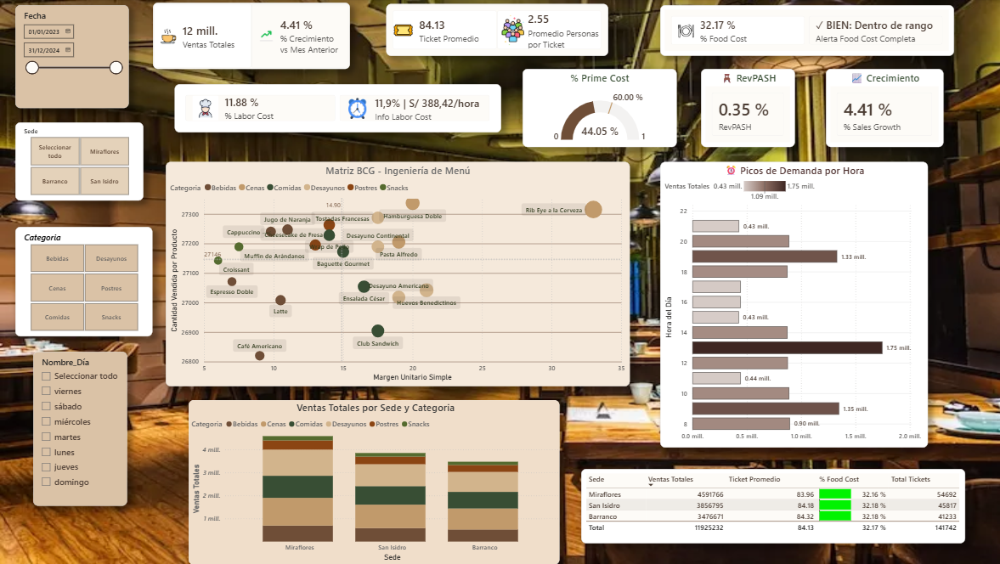

# ☕ Dashboard de Control de Gestión: Puku Puku Café

Dashboard interactivo en Power BI para el control de gestión de una cafetería peruana con tres sedes (Miraflores, Barranco y San Isidro). Proyecto académico elaborado con **datos simulados**; no representa información real de ningún negocio.

## 🎯 Objetivo

Reunir en una sola vista los indicadores clave de la operación de la cafetería, para apoyar decisiones sobre ventas, costos, menú y personal.

## ❓ Qué permite responder

- 📈 ¿Cómo evolucionan las ventas y cuánto crecen frente al mes anterior?
- 📍 ¿Qué sedes y categorías generan más ventas?
- ⏰ ¿En qué horas y días se concentra la demanda?
- 🍽️ ¿Qué productos conviene potenciar o revisar según su margen y su popularidad?
- 💰 ¿Los costos de alimentos y de mano de obra están dentro de los rangos esperados?

## 📊 Contenido del dashboard

**Indicadores (KPIs)**
- 💵 Ventas totales y % de crecimiento vs. mes anterior
- 🎟️ Ticket promedio y promedio de personas por ticket
- 🥘 % Food Cost, con alerta de rango
- 👨‍🍳 % Labor Cost y costo laboral por hora
- ⚖️ % Prime Cost (food cost + labor cost) frente a una meta de referencia
- 🪑 RevPASH (ingreso por asiento disponible por hora)

**Visualizaciones**
- 🧩 Matriz BCG (ingeniería de menú): margen unitario vs. cantidad vendida por producto y categoría
- ⏰ Picos de demanda por hora
- 🏢 Ventas totales por sede y categoría
- 📋 Tabla resumen por sede: ventas, ticket promedio, % food cost y total de tickets

**Filtros:** 📅 fecha (2023–2024), 📍 sede, 🏷️ categoría y 🗓️ día de la semana.

## 🔢 Resumen en cifras (2023–2024, todas las sedes)

| Indicador | Valor |
|---|---|
| Ventas totales | S/ 11,925,232 |
| Total de tickets | 141,742 |
| Ticket promedio | S/ 84.13 |
| Personas por ticket | 2.55 |
| % Food Cost | 32.17% |
| % Labor Cost | 11.88% |
| % Prime Cost | 44.05% |
| Crecimiento vs. mes anterior | +4.41% |

## 🔎 Hallazgos principales

- 📍 **Miraflores lidera las ventas**, con cerca del 38.5% del total (S/ 4,591,766), seguida de San Isidro (~32.3%) y Barranco (~29.2%). La diferencia viene del **volumen de tickets y no del gasto**: Miraflores atiende 54,692 tickets (frente a 45,817 y 41,233) y, aun así, tiene el ticket promedio más bajo (83.96 vs. 84.18 y 84.32). El ticket es casi igual en las tres sedes.
- ⏰ **La demanda se concentra en tres franjas**: desayuno (~9 h, 1.35 mill.), almuerzo (~13 h, el pico más alto con 1.75 mill.) y cena (~19 h, 1.33 mill.). Fuera de esos picos, las ventas por hora bajan a cerca de 0.43 mill., lo que ayuda a planificar los turnos del personal.
- 💰 **Los costos están bajo control**: el food cost (32.17%) está dentro del rango definido y es casi idéntico entre sedes (32.16%–32.18%). Con un labor cost de 11.88% (S/ 388.42 por hora), el prime cost (44.05%) queda bien por debajo de la referencia de 60% del dashboard.
- 🥩 **Ingeniería de menú**: la cantidad vendida por producto es muy pareja (entre ~26,800 y ~27,300 unidades), así que el **margen es lo que diferencia a los productos**. El Rib Eye a la Cerveza tiene el margen unitario más alto (~33). En cambio, Croissant, Espresso Doble, Muffin de Arándanos, Café Americano y Latte tienen márgenes bajos (menos de 10): oportunidad para revisar precios o recetas. El Café Americano, además, es de los que menos se vende.
- 🧁 **Postres y snacks aportan poco** en las tres sedes, mientras que comidas, cenas y desayunos concentran la mayor parte de las ventas. Hay espacio para impulsar la venta cruzada con postres y bebidas.
- 📈 **Crecimiento positivo**: las ventas suben 4.41% frente al mes anterior.

## 🛠️ Herramientas

Power BI Desktop · DAX · [Power Query]

## 📂 Contenido del repositorio

- `dashboard puku.pbix`: archivo del dashboard en Power BI
- `dashboard_puku_imagen.png`: vista previa del dashboard
- `README.md`: descripción del proyecto

## 🚀 Cómo abrirlo

1. Descarga el archivo `dashboard puku.pbix`.
2. Ábrelo con [Power BI Desktop](https://powerbi.microsoft.com/desktop/) (gratuito para Windows).
3. Para una vista rápida, mira la imagen de arriba.

## 👤 Autor

**César Fabrizio Salas Molina** · [LinkedIn](https://www.linkedin.com/in/c%C3%A9sar-fabrizio-salas-molina-84565b401) · [GitHub](https://github.com/FabrizioSalas)
